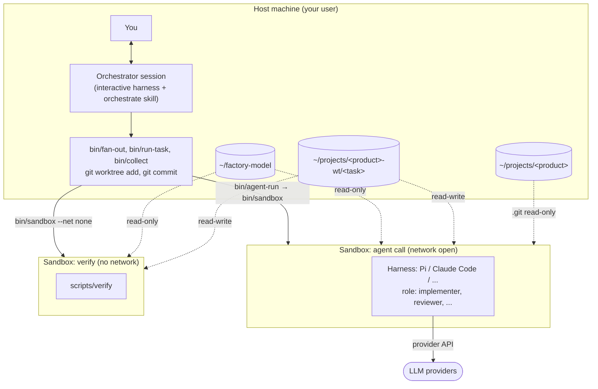
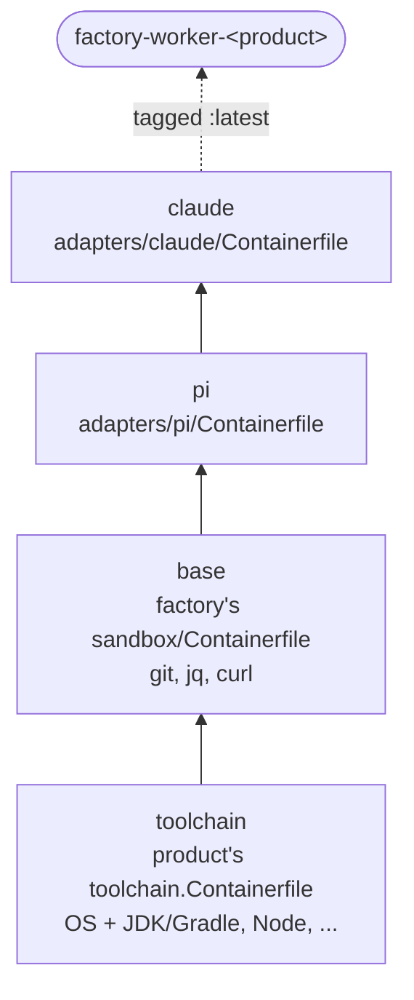
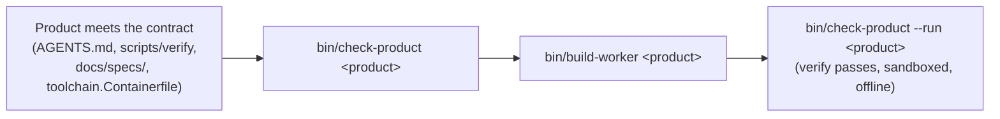
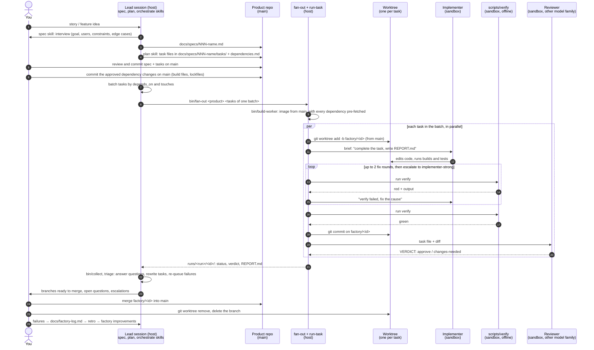
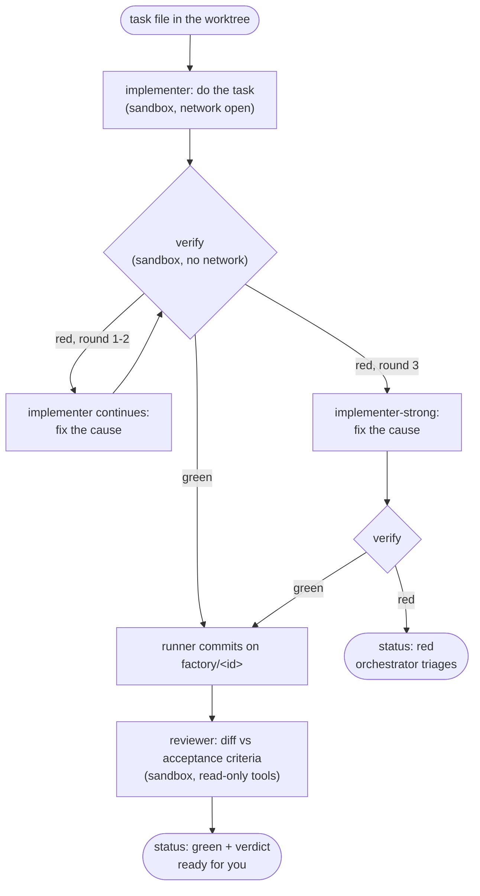

# How the factory works

The big picture in diagrams: which directories exist, where things run, and what happens between
"here's a story" and "it's merged". The build steps are in `building-the-factory.md`.

---

## 1. Three directories

```
~/factory-model/                 THE FACTORY: how work is done (this repo)
├── bin/                         scripts: start, sandbox, build-worker, agent-run, run-task, fan-out, collect
├── config/                      routing.json (role → harness + model), sandbox-env (allowed env vars)
├── roles/ skills/ guards/       role prompts, skills, guard scripts
├── sandbox/Containerfile        factory base layer of the worker image
├── adapters/<harness>/          everything harness-specific, incl. that harness's image layer
└── runs/<run>/<task>/           logs of each run: briefs, calls.log, verify.log, status, review

~/projects/<product>/            THE PRODUCT: what is being built (its own repo)
├── AGENTS.md                    product knowledge for agents
├── scripts/verify               the one health check (exit 0 = healthy)
├── toolchain.Containerfile      the image the product builds and tests in
├── docs/specs/                  specs and task files
└── .git/                        the product's history, shared by all of its worktrees

~/projects/<product>-wt/         THE WORKTREES: one checkout per task in progress
├── 012-csv-export/              branch factory/012-csv-export
└── 013-date-filter/             branch factory/013-date-filter
```

**The worktrees directory** is the one that's easy to forget. A *git worktree* is an extra
working copy of the same repo, checked out on its own branch. All worktrees share the product's
`.git`, so they cost almost nothing and every commit lands in the product's history. The factory
creates one worktree per task, so several agents can work in parallel without touching each
other's files or your own checkout in `~/projects/<product>/`. The worktrees sit *outside* the
product repo so they never appear inside it. Each one is deleted after you merge its branch.

| | Factory | Product | Worktrees |
|---|---|---|---|
| Is | A git repo | A git repo | Extra checkouts of the product repo |
| Holds | Process knowledge, same for every product | Domain knowledge, code, tests | One task's branch |
| Changed by | You (factory improvements) | You (merging) | Agents (inside the sandbox) |
| Lives | For good | For good | Until the task is merged |

**The contract between factory and product** is the only thing the factory knows about a product:
`AGENTS.md`, `scripts/verify`, `docs/specs/` and `toolchain.Containerfile` (holding every
dependency `main` declares).

---

## 2. Hosts and sandboxes

Everything runs on one machine. You, the orchestrator and the factory scripts run on the host.
Each agent call and each verify run gets its own short-lived sandbox (a container that is
removed when the command ends). Only the worktree and the run directory carry over from one call
to the next.



What a sandbox can and can't reach:

| Mounted | Access | Not there at all |
|---|---|---|
| `~/factory-model` | read-only, so agents can't change their own guards, roles or routing | your home directory, SSH keys |
| the task's worktree | read-write, the only code the agent may change | cloud and push credentials |
| the task's run directory (`runs/<run>/<task>/`) | read-write | other repos and other worktrees |
| the product's shared `.git` | read-only, so `git diff` works but history can't be rewritten | env vars not listed in `config/sandbox-env` |

### The worker image

With the container backends (`SANDBOX=docker`, the default, or `podman`), every sandbox for a product starts
from that product's worker image. `bin/build-worker` builds it once per product, layer by layer,
each built `FROM` the one below:



The product is at the bottom because it brings the OS. Only the harnesses `config/routing.json`
uses are included. The factory's code isn't in the image: it's mounted read-only at run time, so
changing a guard or a role needs no rebuild. With `SANDBOX=bwrap` there's no image, and the
host's own `/usr` provides the toolchain and the harnesses.

---

## 3. From story to merge

### Once per product: plug it in



### Every story



Steps 1–6 are interactive and happen once per story. Steps 7 and later repeat for each batch of
tasks until the story's tasks are merged. Three rules hold for every task:

- **Dependencies change on `main`, never in a task.** The planner lists the dependency changes a
  spec needs, you approve them and commit them on `main` before the tasks run, and the worker
  image is rebuilt with them. Offline verify stops a task that changes them anyway where the
  build tool downloads outside the worktree; elsewhere the reviewer sees the change in the diff.
- **Done means verified.** Only `scripts/verify` decides a task is green, checked by the runner
  after the agent exits. The model can't declare itself done.
- **You merge.** Agents never push or merge. The runner commits to local `factory/<id>`
  branches, and you decide what reaches `main`.

### Inside one task (`bin/run-task`)



Every box that says *sandbox* is a separate, fresh container. Nothing carries over between them
except what's in the worktree and the run directory.

---

## 4. Where things end up

| Artifact | Where | Kept |
|---|---|---|
| Spec, task files | product: `docs/specs/` | yes, on `main` |
| Code changes, `REPORT.md` | worktree, branch `factory/<id>` | merged by you, or dropped |
| Briefs, `calls.log`, `verify.log`, `status`, `diff.patch`, review | factory: `runs/<run>/<id>/` | gitignored, local history |
| Approved dependency changes | product: build files and lockfiles, plus `docs/specs/NNN-name/dependencies.md` | yes, on `main` |
| Failures and their fixes | factory: `docs/factory-log.md` | yes, drives factory improvements |
| Product knowledge learned | product: `AGENTS.md` | yes |
| Process knowledge learned | factory: skills, roles, guards, routing | yes |
